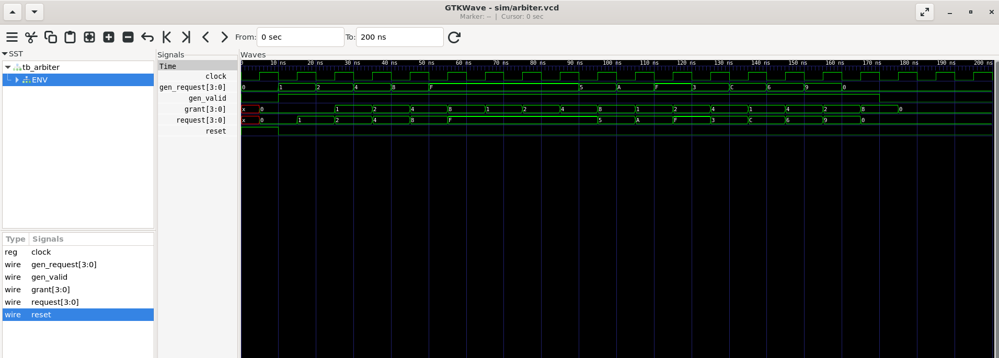

# Round Robin Arbiter — Functional Verification

This project implements a 4-requester Round Robin Arbiter and verifies its behavior using a layered SystemVerilog testbench.

## Features

- Four requesters with 4-bit request and grant signals
- Round-robin priority rotation
- One-hot grant checking
- Reset functionality
- Monitor and scoreboard-based verification
- GTKWave waveform analysis

## Arbitration Principle

The arbiter selects one active requester at a time. After granting a requester, it advances the priority so other continuously requesting devices get opportunities to access the shared resource.

For continuous requests (`request = 1111`), the grant rotates between the four requesters.

## Project Structure

```text
round_robin_arbiter/
├── design/
│   └── round_robin_arbiter.sv
├── tb/
│   ├── arbiter_interface.sv
│   ├── arbiter_transaction.sv
│   ├── arbiter_generator.sv
│   ├── arbiter_driver.sv
│   ├── arbiter_monitor.sv
│   ├── arbiter_scoreboard.sv
│   ├── arbiter_environment.sv
│   └── tb_arbiter.sv
├── images/
│   └── waveform.png
├── sim/
├── .gitignore
└── README.md
```

## Layered Testbench Architecture

```text
Generator
    |
    v
Driver
    |
    v
Round Robin Arbiter (DUT)
    |
    v
Monitor
    |
    v
Scoreboard
```

- **Generator:** Produces different request patterns.
- **Driver:** Applies requests to the DUT on clock edges.
- **DUT:** Performs round-robin arbitration.
- **Monitor:** Observes requests and grants.
- **Scoreboard:** Checks one-hot grants and verifies that grants correspond to active requests.
- **Environment:** Connects the verification components.

## Tools Used

- SystemVerilog
- Icarus Verilog
- GTKWave
- Ubuntu / WSL
- Visual Studio Code

## Compile

Run from the project root:

```bash
iverilog -g2012 -o sim/arbiter_sim design/round_robin_arbiter.sv tb/arbiter_interface.sv tb/arbiter_transaction.sv tb/arbiter_generator.sv tb/arbiter_driver.sv tb/arbiter_monitor.sv tb/arbiter_scoreboard.sv tb/arbiter_environment.sv tb/tb_arbiter.sv
```

## Run Simulation

```bash
vvp sim/arbiter_sim
```

## View Waveform

```bash
gtkwave sim/arbiter.vcd
```

## GTKWave Result



The waveform shows changing request patterns and rotating grants. For continuous requests, the arbiter rotates grants through the four requesters.

## Verification Checks

- At most one requester is granted per cycle.
- A grant must correspond to an active request.
- No grant is issued when there are no active requests.
- Continuous requests demonstrate rotating priority.

## Learning Outcomes

- Round-robin arbitration
- Priority rotation and fairness
- Layered testbench design
- Functional verification using a scoreboard
- Simulation and waveform analysis
